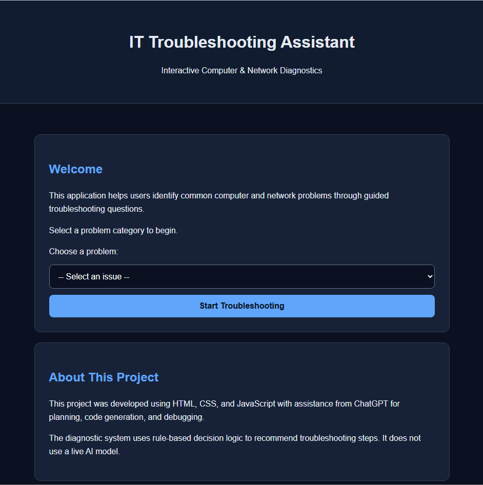
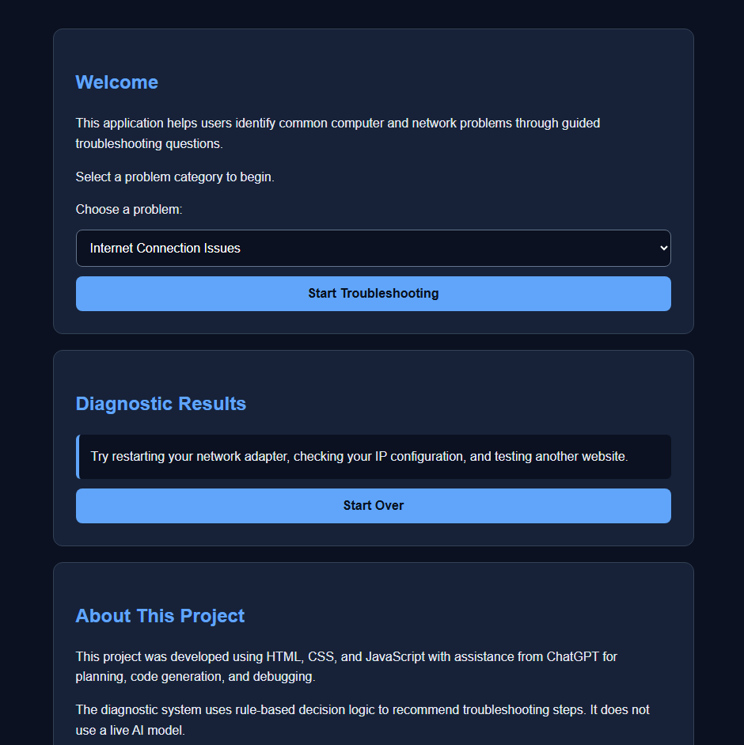

# IT Troubleshooting Assistant

**Developer:** Ayden Manuel  
**Course:** COSC 4272 Senior Seminar  
**Project Type:** AI-Assisted Software Development

## Project Overview

The IT Troubleshooting Assistant is a browser-based
application designed to help users identify common
computer and network problems.

The application guides users through interactive
diagnostic questions and provides troubleshooting
recommendations based on their responses.

This project was developed with assistance from ChatGPT
to demonstrate AI-assisted software engineering,
including planning, coding, testing, and documentation.

The application uses rule-based decision logic rather
than a live artificial intelligence model.

## Features

- Four troubleshooting categories
- Interactive Yes/No diagnostic questions
- Rule-based troubleshooting recommendations
- Input validation
- Restart functionality
- Responsive interface
- Browser-based operation
- No account registration required

## Technologies Used

- HTML5
- CSS3
- JavaScript
- Git and GitHub
- GitHub Pages
- ChatGPT

## Live Application

[Launch IT Troubleshooting Assistant](https://jakman5480-eng.github.io/github-portfolio/ai-troubleshooter/)

## Installation Instructions

No additional software installation is required.

### Option 1: Use the Live Application

1. Open the live application link above.
2. Select a troubleshooting category.
3. Click Start Troubleshooting.
4. Answer the diagnostic questions.
5. Review the recommended troubleshooting steps.

### Option 2: Run Locally

1. Download or clone the GitHub repository.
2. Open the ai-troubleshooter folder.
3. Locate index.html.
4. Open index.html in a modern web browser.

## Usage Guide

1. Select a problem from the dropdown menu.
2. Click Start Troubleshooting.
3. Read the displayed diagnostic question.
4. Answer Yes or No.
5. Continue until a recommendation appears.
6. Click Start Over to begin another diagnostic session.

## Supported Problems

### Internet Connection Issues

Provides guidance for connectivity problems,
network adapters, routers, and internet outages.

### Slow Computer Performance

Provides recommendations for identifying
resource usage, background processes,
storage problems, and software performance.

### Computer Startup Problems

Provides basic guidance for diagnosing
power and startup-related issues.

### Software Crashing

Provides recommendations for application
updates, compatibility issues, and error logs.

## Screenshots

Screenshots of the application will be added
to the screenshots folder.

Planned screenshots include:

- Application homepage
- Diagnostic questions
- Troubleshooting results

## Software Documentation

- [Requirements Specification](requirements.md)
- [Project Planning Document](project-plan.md)

## Testing

The application has been manually tested
using the available troubleshooting categories.

Testing included:

- Category selection
- Yes/No diagnostic responses
- Recommendation generation
- Restart functionality
- Input validation

## AI-Assisted Development

ChatGPT assisted with:

- Project planning
- Requirements analysis
- Application design
- HTML, CSS, and JavaScript development
- Troubleshooting logic
- Testing guidance
- Documentation preparation

AI prompts, responses, modifications, and
implementation results are documented separately
in the AI Usage Log.

## Future Enhancements

Potential future improvements include:

- Integration with a live AI model
- Additional troubleshooting categories
- More advanced diagnostic questions
- Search functionality
- Troubleshooting history
- Improved accessibility

## Screenshots

### Application Homepage

### Diagnostic Demonstration

## Developer

Ayden Manuel

Computer Science Student  
Lamar University

[GitHub Profile](https://github.com/jakman5480-eng)

[Professional Portfolio](https://jakman5480-eng.github.io/github-portfolio/)
